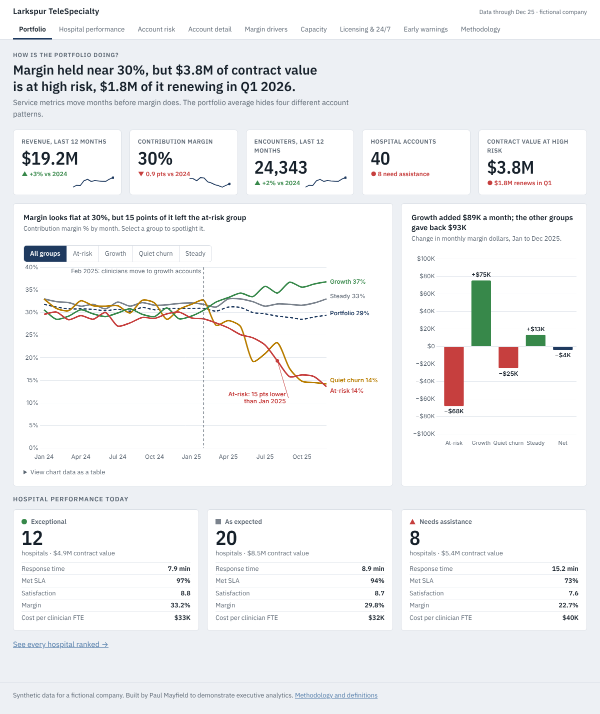

# Larkspur TeleSpecialty: executive dashboard (portfolio piece)

A mobile-friendly executive dashboard that turns operating data into decisions a CEO and CFO can act on.
**Everything is synthetic.** Larkspur TeleSpecialty and every hospital in it are fictional.



## What it answers
1. **How is the portfolio doing?** Margin looks flat near 30%, but four account groups are moving in opposite directions.
2. **Which hospitals are exceptional, as expected, or need assistance?** Based on clinicians assigned versus needed, and response time against the 10-minute target.
3. **Which accounts might leave, and why?** Ranked by risk flags and renewal date.
4. **What drives margin?** Slow response lowers satisfaction first, then margin, because backfilled shifts cost more.
5. **Is clinician capacity in the right place?** Utilization, where to move capacity first, which state licenses would unlock growth, and 24/7 shift coverage.
6. **What would have warned us earlier?** Staffing cuts and slow response, months before margin moved.

## Design
Informed by Tableau's dashboard best practices (answer first, key view upper-left, two or three views per page, big-number tiles, color to spotlight, annotations, cross-highlighting). Details on the methodology page.

## Run it
```bash
python3 scripts/generate_data.py   # writes data/*.csv (fixed seed, identical every run)
python3 scripts/build_metrics.py   # writes site/data/metrics.json
python3 scripts/validate.py        # section 13 checks; must pass
python3 -m http.server --directory site
```
Then open http://localhost:8000. Needs Python 3 with `pandas` and `numpy`.

## Project rules
`CLAUDE.md` is the source of truth: ground rules, data specification, metric definitions, page design. Thresholds are in `config/thresholds.json`.

## Publishing
`.github/workflows/pages.yml` deploys the `site/` folder to GitHub Pages on every push to `main`. One-time setup: repository Settings, Pages, Source = GitHub Actions.
